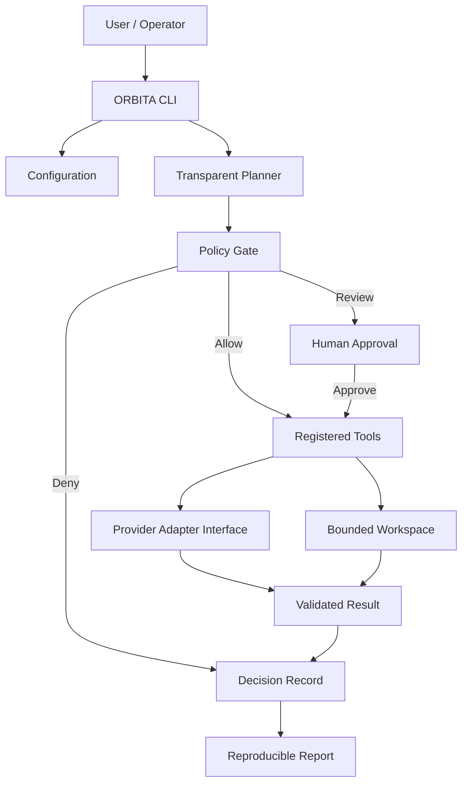
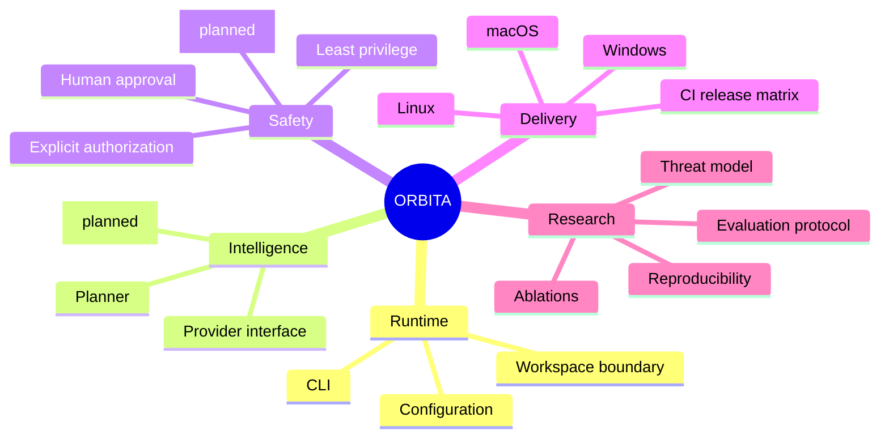

# ORBITA

**Open Runtime for Building Intelligent Task Agents**

ORBITA is an original, cross-platform foundation for building transparent, human-supervised agent workflows. It focuses on provider neutrality, explicit authorization, bounded workspace access, auditable plans, and reproducible packaging.

> Status: research prototype / early development. This repository is not a drop-in replacement for ARTEX and does not claim feature parity. The current CLI implements a small tested core; model adapters, a graphical console, persistent run history, and production deployment are planned work.

## Architecture at a glance



## Working mind map



## Current capabilities

- Cross-platform Go CLI source (Windows, macOS, and Linux targets).
- Deterministic, inspectable task-plan skeleton.
- Fail-closed policy decisions for known low-impact operations, review-gated writes, and unknown tools.
- Workspace path validation that rejects lexical traversal outside its configured root.
- Provider-neutral model interface, ready for separately tested adapters.
- Unit tests and CI build/test matrix.

### Quick start

Requirements: Go 1.23 or newer.

```bash
git clone https://github.com/anku0669/orbita.git
cd orbita
go test ./...
go run ./cmd/orbita version
go run ./cmd/orbita status
go run ./cmd/orbita plan --goal "review a local project"
go run ./cmd/orbita policy-check --tool workspace.read --target ./ --authorized
```

Environment variables:

| Variable | Default | Purpose |
|---|---|---|
| `ORBITA_WORKSPACE` | `./workspace` | Root for bounded local workspace operations |
| `ORBITA_LOG_LEVEL` | `info` | `debug`, `info`, `warn`, or `error` |

## Build for supported operating systems

The Go standard toolchain can cross-compile the CLI without a platform-specific runtime. Run the commands below from the repository root:

```bash
# Linux
GOOS=linux GOARCH=amd64 go build -o dist/orbita-linux-amd64 ./cmd/orbita
GOOS=linux GOARCH=arm64 go build -o dist/orbita-linux-arm64 ./cmd/orbita

# macOS (Intel and Apple Silicon)
GOOS=darwin GOARCH=amd64 go build -o dist/orbita-darwin-amd64 ./cmd/orbita
GOOS=darwin GOARCH=arm64 go build -o dist/orbita-darwin-arm64 ./cmd/orbita

# Windows
GOOS=windows GOARCH=amd64 go build -o dist/orbita-windows-amd64.exe ./cmd/orbita
GOOS=windows GOARCH=arm64 go build -o dist/orbita-windows-arm64.exe ./cmd/orbita
```

The release workflow builds and attaches these binaries when a `v*` tag is pushed. These are CLI binaries, not installers. macOS `.dmg`, Windows `.msi`, and Linux `.deb`/`.rpm` packages require additional packaging and signing work before being advertised as production installers.

## Security model and limitations

ORBITA is designed to make authorization and review explicit. The baseline policy is deny-by-default for unknown tools. Writes require human review. Workspace operations are intended to be rooted in a configured directory.

Important limitations: the starter policy is not a full sandbox; lexical path checks alone do not defeat every symlink or race-based escape; no arbitrary command execution tool is provided; no untrusted agent output should be executed. Production integrations must add OS-level isolation, robust canonical-path and symlink handling, scoped credentials, rate limits, structured audit persistence, and independent security testing.

Only use ORBITA against systems, files, and services you own or are explicitly authorized to test.

## Research

See [`paper/ORBITA-research-draft.md`](paper/ORBITA-research-draft.md) for the research framing, system design, threat model, research questions, and proposed evaluation. Results are intentionally not fabricated. The paper is a draft until experiments are run and measured results are added.

## Roadmap

1. Harden filesystem containment against symlinks and TOCTOU races.
2. Add an append-only audit event schema and export format.
3. Add model-provider adapters behind the `provider.Model` interface.
4. Add approval tokens with expiry, scope, and replay protection.
5. Add a web console and local API with authentication and CSRF protection.
6. Add signed builds, SBOMs, provenance attestations, and platform installers.
7. Run the evaluation in the research paper and publish raw data and scripts.

## License and attribution

ORBITA's starter implementation is authored independently and is not a fork or copy of ARTEX. It was conceived after reviewing the public ARTEX repository's broad agent-platform scope. Do not assume ARTEX's license applies to ORBITA; this project uses the MIT License included here. Any future reuse of third-party code must be separately reviewed for license compatibility and attributed as required.
